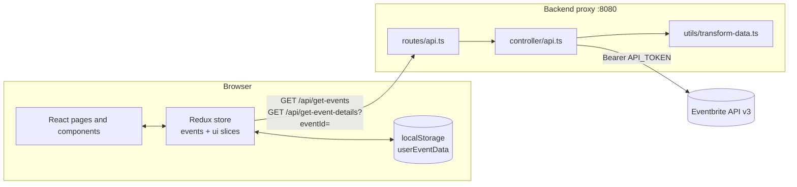

# Event App: Architecture

## What the app does

Event App is a browser for events that one organization has published on [Eventbrite](https://www.eventbrite.com/). A user can:

- See every event of the configured Eventbrite organization, as tiles.
- Search events by title and filter by category.
- Open a detail page for one event (it can be opened directly by URL).
- Add tickets for an event to a **wish list** and remove them again. Ticket counts are capped by event capacity.
- See wish list totals (item count, total price) and download the wish list as a PDF.
- Create a new event through a form. The event exists only in the browser session. It is not sent to Eventbrite.

The wish list survives page reloads because it is stored in `localStorage`. Nothing is written back to Eventbrite. The app is read-only toward the API.

## System overview



The repository has two independent npm projects. There is no root `package.json`, workspace, or shared code between them.

| Folder | Stack | Role |
|---|---|---|
| `backend/` | Node, Express 4, TypeScript (compiled to CommonJS), `request`, `dotenv` | Hides the Eventbrite token and reshapes Eventbrite responses |
| `frontend/` | Create React App 5, React 18, Redux Toolkit, React Router 6, Formik + Yup, `@react-pdf/renderer` | UI, state, wish list persistence |

The frontend existed first and called Eventbrite directly. That version still lives on the `frontend` git branch, with credentials in `frontend/src/utils/config.json`. The backend was added later (PR #3, #4) so the token no longer ships to the browser, and then ported from JavaScript to TypeScript (PR #5).

---

## Backend deep dive

### File layout

```
backend/
├── env-data/.env            # Eventbrite credentials and URL templates (tracked in git)
├── src/
│   ├── app.ts               # Express app: CORS header middleware, mounts /api, listens on 8080
│   ├── routes/api.ts        # Two GET routes
│   ├── controller/api.ts    # Loads env, calls Eventbrite, sends transformed JSON
│   ├── utils/transform-data.ts  # Eventbrite payload -> EventbriteEvent
│   └── types/events.ts      # EventbriteEvent class + EventbriteResponseEvent type
├── tsconfig.json            # src -> dist, CommonJS, ES2018, strict: false
└── package.json             # "start": "nodemon dist/app.js"
```

### Build and run lifecycle

1. `npx tsc` compiles `src/**/*.ts` into `dist/` with the same folder structure. There is no `build` script in `package.json`.
2. `npm start` runs `nodemon dist/app.js`. nodemon watches the compiled JavaScript, not the TypeScript. After a source edit you must run `tsc` again, or keep `tsc -w` running in a second terminal.
3. `app.ts` imports `routes/api.ts`, which imports `controller/api.ts`. The controller's module body runs at this moment:
   - `dotenv.config({ path: path.resolve(__dirname, '../../env-data/.env') })`. From `dist/controller/` this resolves to `backend/env-data/.env`. The path depends on the `dist` folder depth, so moving the controller breaks env loading.
   - The organization events URL is built once, by replacing `[organizationId]` in `API_ALL_EVENTS_URL`.
   - The `Authorization: Bearer <API_TOKEN>` header object is built once.
4. The server listens on port `8080`. The port is hardcoded, and the frontend hardcodes `http://localhost:8080` as well.

Because step 3 calls `.replace()` on `process.env.API_ALL_EVENTS_URL` at import time, a missing variable crashes the server at startup with a `TypeError`. That is the only startup validation. An empty `ORGANIZATION_ID` or `API_TOKEN` does not fail until the first request.

### Configuration

`backend/env-data/.env`:

| Variable | Value in repo | Purpose |
|---|---|---|
| `ORGANIZATION_ID` | empty | Eventbrite organization whose events are listed |
| `API_TOKEN` | empty | Eventbrite private token, sent as a Bearer token |
| `API_BASE_URL` | `https://www.eventbriteapi.com/v3` | API root |
| `API_ALL_EVENTS_URL` | `/organizations/[organizationId]/events/?expand=ticket_availability,venue,category` | List endpoint template |
| `API_SINGLE_EVENT_URL` | `/events/[eventId]/?expand=ticket_availability,venue,category` | Detail endpoint template |

The `expand` parameter makes Eventbrite inline the `venue`, `category`, and `ticket_availability` objects. The transformer depends on all three. If you remove one from the URL, the transformer reads `undefined` and throws.

The file is tracked in git and the repo has no `.gitignore`. Put real credentials only in a local, uncommitted copy.

### HTTP surface

`app.ts` adds one middleware before the routes. It sets `Access-Control-Allow-Origin: *` and `Access-Control-Allow-Methods: GET` on every response. The frontend only sends simple GET requests without custom headers, so the browser sends no CORS preflight and this is enough.

| Method and path | Query | Eventbrite call | Success response | Failure response |
|---|---|---|---|---|
| `GET /api/get-events` | none | `GET {API_BASE_URL}/organizations/{ORGANIZATION_ID}/events/?expand=...` | `200`, JSON array of `EventbriteEvent` | `500`, `{ "error": "<message>" }` |
| `GET /api/get-event-details` | `eventId` | `GET {API_BASE_URL}/events/{eventId}/?expand=...` | `200`, one `EventbriteEvent` object | `500`, `{ "error": "<message>" }` |

The frontend calls `/api/get-event-details/?eventId=...` with a trailing slash. Express routing is non-strict by default, so the route still matches.

Express has no 404 handler or error middleware (`app.ts` has a `// Todo` for it). Unknown paths get Express's default HTML 404 page.

### Request lifecycle (both handlers)

The two handlers in `controller/api.ts` follow the same pattern:

```
Express route
  └─ handler builds URL from env templates
       └─ request({ url, headers }, callback)          // deprecated `request` lib, callback style
            └─ callback(error, response, body)
                 try:
                   response.statusCode !== 200  -> throw "Unable to fetch data from Eventbrite!"
                   JSON.parse(body)
                   transformAllEvents(...) / transformEvent(...)
                   res.json(result)                     // 200
                 catch:
                   res.status(500).json({ error: error.message })
```

Things to know about this flow:

- **The `error` argument of the callback is ignored.** On a network failure (DNS, timeout, refused connection) `response` is `undefined`. Reading `response.statusCode` then throws a `TypeError`, which the `catch` block turns into a 500. The client sees a message like `Cannot read properties of undefined (reading 'statusCode')` instead of a clear network error.
- **Every Eventbrite error becomes a 500** with the same generic message. A 401 (bad token), 404 (unknown event), and 429 (rate limit) all look the same to the frontend.
- **`await` on the transformers does nothing.** The transformers are synchronous. The callbacks are `async` only so `await` compiles.
- **No caching.** Every page load that needs data goes to Eventbrite.
- **Pagination is not handled.** Eventbrite paginates list endpoints and returns a `pagination` object next to `events`. The handler reads only the first page, so organizations with many events show only part of them.
- **`eventId` is not validated or encoded.** It is placed into the URL path as is. A missing value becomes the string `undefined` and gives a 500. A crafted value can change the path or query of the Eventbrite request. The host stays fixed, but the request still carries the organization's token. Validate it as a numeric ID before using it.

### Data transformation

`utils/transform-data.ts` is the contract between Eventbrite and the frontend. It turns the large Eventbrite event object into a flat `EventbriteEvent` (declared as a class with constructor parameter properties in `types/events.ts`).

| `EventbriteEvent` field | Source in Eventbrite payload | Notes |
|---|---|---|
| `id` | `id` | String |
| `title` | `name.text` | |
| `description` | `description.text` | Plain text, not HTML |
| `date` | `start.local` | Local time string without time zone |
| `location` | `venue.name` | `'Online'` if there is no venue name |
| `address` | `venue.address.localized_address_display` | `''` if missing |
| `imageOriginal` | `logo.original.url` | Full-size image |
| `image` | `logo.url` | Cropped image |
| `category` | `category.name` | Used for the category filter |
| `availableTickets` | `capacity` | Event capacity, **not** tickets left to sell |
| `capacity` | `capacity` | |
| `price` | `ticket_availability.maximum_ticket_price.value` | Integer in minor units (cents) |
| `displayPrice` | `ticket_availability.maximum_ticket_price.major_value` | String, for example `"25.00"` |
| `currency` | `ticket_availability.maximum_ticket_price.currency` | |
| `ticketsWishList` | constant `0` | The frontend fills this from `localStorage` |

The price is the **maximum** ticket price. Events with several ticket types show only their most expensive one.

`availableTickets` and `ticketsWishList` are not Eventbrite concepts. The backend creates them so the frontend can track wish list quantities against capacity.

Optional fields are guarded only for `venue`. These fields are read without a guard: `logo.original.url`, `logo.url`, `category.name`, `description.text`, and `ticket_availability.maximum_ticket_price`. Eventbrite returns `null` for `logo` and `category` when they are not set, and for free or ticketless events the price can be missing. One such event makes the transform throw. The two endpoints fail differently:

- `transformEvent` (detail endpoint): the throw is caught in the controller, so the client gets a 500.
- `transformAllEvents` (list endpoint): it catches the throw and **returns** `new Error('Unable to transform data!')`. The controller then sends that with `res.json(...)`. An `Error` object has no enumerable properties, so the client gets **`200` with body `{}`**. One bad event therefore hides all events. On the frontend, the `replaceEvents` reducer tries to spread `{}` as an array and throws, and the thunk shows a generic error notification.

### Typing

`tsconfig.json` sets `strict: false`, so `noImplicitAny` and `strictNullChecks` are off. The `!` non-null assertions in the controller are decorative. `process.env.API_SINGLE_EVENT_URL.replace(...)` compiles without one. `catch (error)` gives `any`, so `error.message` compiles without a type check.

`EventbriteResponseEvent` describes only the fields the transformer reads. It marks `venue`, `logo`, and `category` as always present, which hides the null cases above from the compiler.

### Contract drift with the frontend

The frontend declares its own `event` interface in `frontend/src/types/index.ts`. Nothing shared enforces it, and it disagrees with the backend in two places:

| Field | Backend `EventbriteEvent` | Frontend `event` | Runtime |
|---|---|---|---|
| `id` | `string` | `number` | String. `EventDetail.js` compares with `params.eventId` (string), so it works. Locally created events use `Date.getTime().toString()`, also a string. |
| `displayPrice` | `string` | `number` | String. Components use `PropTypes.string`. |

When you change the response shape, update `backend/src/types/events.ts`, `backend/src/utils/transform-data.ts`, `frontend/src/types/index.ts`, `frontend/src/utils/transform-event-data.js` (form to event), and the component PropTypes together.

### Backend issues and suggested fixes

| Area | Current behavior | Suggested fix |
|---|---|---|
| Network errors | `error` ignored, crash on `response.statusCode` gives an unclear 500 | Check `error` first. Return 502 with a clear message. |
| Upstream status | All non-200 become 500 | Forward or map 401, 404, 429 |
| List transform failure | `200 {}` | Throw instead of returning `Error`, or skip only the bad event |
| Null fields | `logo`, `category`, price unguarded | Optional chaining with defaults |
| Pagination | First page only | Follow `pagination.has_more_items` with `continuation` |
| Input validation | `eventId` used raw | Require `^\d+$`, otherwise 400 |
| HTTP client | `request` (deprecated since 2020) | Global `fetch` (Node 18+) or `axios` |
| Config | `.env` tracked, no `.gitignore` | Commit `.env.example`, ignore `.env`, `node_modules`, `dist` |
| Startup | Crash only if URL variables are missing | Validate all five variables at boot |
| Port and API URL | Hardcoded 8080 and `localhost:8080` | `PORT` env var on the backend, `REACT_APP_API_URL` on the frontend |
| Error handling | No 404 or error middleware | Add both in `app.ts` |
| Tests | None | Unit-test `transform-data.ts` with fixture payloads |

---

## Frontend architecture

### Routing

`App.tsx` builds a `createBrowserRouter` tree. `RootLayout` (navigation bar and `<Outlet/>`) wraps every page. `Error` is the route error element.

| Path | Page | Data needed |
|---|---|---|
| `/` | `Home` | All events. Filters by title search and category on the client. |
| `/wishlist` | `WishList` | All events, filtered to `ticketsWishList > 0`. Shows totals and PDF download. |
| `/new-event` | `CreateEvent` | None. Formik form. |
| `/event/:eventId` | `EventDetail` | One event. Fetches it alone if it is not already in the store. |

On mount, `App` calls `localStorageHelper.initStorage()` so the `userEventData` key always exists.

### State (Redux Toolkit)

```
store
├── ui      { isLoading, notification, isAnimatedCounter }
└── events  { events[], totalWishList, totalPrice, areEventsReplaced }
```

Thunks in `store/event-actions.ts`:

| Thunk | Calls | Reducer |
|---|---|---|
| `getEventsData()` | `GET /api/get-events` | `replaceEvents`, which replaces the whole list and sets `areEventsReplaced = true` |
| `getSingleEvent(id)` | `GET /api/get-event-details` | `appendEvent`, which pushes one event |
| `addNewEvent(event)` | none (fakes 1 s latency with `setTimeout`) | `createEvent`, which adds the event at the front of the list |

Each thunk toggles `ui.isLoading` and writes errors to `ui.notification`.

**Why `areEventsReplaced` exists.** If a user opens `/event/123` first, `appendEvent` puts one event in the store. If `Home` then checked `events.length > 0`, it would skip the list fetch and show only that one event. So `Home` and `WishList` fetch whenever `areEventsReplaced` is false. The flag is set only by a full list load.

A side effect of the flag: after the list is loaded once, it is never fetched again during the session. Events created with `createEvent` stay in the list until reload. Reloading the page resets the store, so they are lost.

### Wish list persistence

`utils/local-storage.js` exposes a small module around one `localStorage` key:

```json
{ "userEventData": { "wishlist": { "<eventId>": <qty> } } }
```

The reducers in `events-slice.ts` call this module directly. Redux reducers are normally pure, but here they have side effects:

- **`addToWishLst` / `removeFromWishList`** update the event's `ticketsWishList` and `availableTickets` and the totals, then mirror the change into `localStorage`. If the user cleared `localStorage`, `rebuiltStorage` writes it again from the current store.
- **`replaceEvents` / `appendEvent`** merge stored quantities into fresh API data. For each stored entry:
  - If the event has no available tickets, or the stored quantity is negative, the entry resets to 0.
  - If the stored quantity is larger than capacity (the event changed on Eventbrite), the entry resets.
  - Otherwise `ticketsWishList` is set from storage, `availableTickets` is reduced, and the totals are updated.

Because the backend sets `availableTickets = capacity`, the cap is event capacity, not real remaining tickets.

### Money

Prices are stored in minor units (`price`, cents). They are divided by 100 only for display. The form converts with `Math.floor(price * 100)`. The wish list totals and PDF totals always show `USD`, whatever each event's `currency` is.

### Other pieces

- **Create event form:** Formik with the Yup schema in `validators/validation-schema.js`, a custom image URL validator, `react-datepicker`. `utils/transform-event-data.js` maps form values to the `event` shape.
- **PDF export:** `components/PdfDownloader/` renders a `@react-pdf/renderer` document of the wish list events and totals in the browser.
- **Styling:** CSS Modules (`*.module.css`) per component.
- **TypeScript migration:** the store, types, and entry files are TypeScript. Pages and components are still `.js` with PropTypes. `pages/Root.js` and `pages/Root.tsx` are duplicates.

### Frontend issues found while reading

- `removeFromWishList` checks `updatedEventId < 0` instead of `updatedEventIndex < 0`. An unknown ID is not caught, and the reducer then reads `stateEvents[-1]` and throws.
- In `addToWishLst`, when the event already has a stored entry, the stored quantity grows by the event's new **total** `ticketsWishList`, not by `qty`. After a reload, `replaceEvents` reads the inflated value. When that value exceeds capacity, the entry resets to 0.
- `src/App.test.js` is the unmodified CRA template test and fails.

---

## End-to-end example: opening the home page

1. The browser loads `/`. `App` makes sure `localStorage.userEventData` exists.
2. `Home` mounts. `areEventsReplaced` is false, so it dispatches `getEventsData()`.
3. The thunk clears the notification, sets `isLoading`, and calls `fetch('http://localhost:8080/api/get-events')`.
4. The backend sends `GET /v3/organizations/{org}/events/?expand=...` with the Bearer token.
5. Eventbrite returns `{ pagination, events: [...] }`. The backend maps the first page of events into `EventbriteEvent[]` and returns them as JSON.
6. The thunk dispatches `replaceEvents(data)`. The reducer merges wish list quantities from `localStorage`, computes the totals, and sets `areEventsReplaced = true`.
7. `isLoading` turns false. `Home` renders the search bar, category tags (unique `category` values), and the filtered event tiles.
